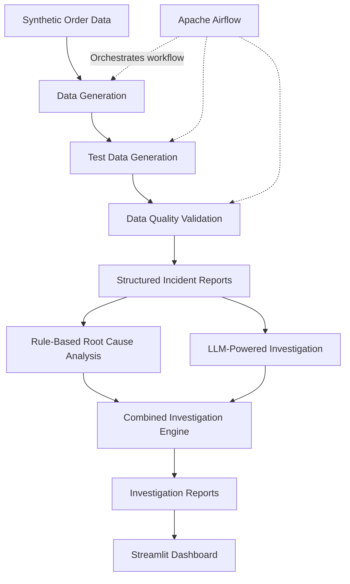

# TraceFlow AI — Intelligent Data Pipeline Investigator

An intelligent data pipeline investigation system that detects data quality issues, identifies potential root causes, and generates AI-assisted investigation reports.

TraceFlow AI combines rule-based data validation, automated root cause analysis, Large Language Model (LLM)-powered investigation, and Apache Airflow orchestration to make data pipeline failures easier to understand and investigate.

## Overview

Data pipelines can fail because of duplicate records, missing values, incorrect calculations, or invalid data. Identifying the reasons behind these failures can require significant manual investigation.

**TraceFlow AI** addresses this problem by automating the investigation process. It validates datasets, identifies data quality issues, generates structured incident reports, and uses AI to provide additional investigation insights.

## Key Features

- **Automated Data Quality Checks:** Detects duplicate order IDs, missing product values, incorrect order totals, and invalid payment statuses.
- **Structured Incident Reporting:** Generates JSON-based reports containing detected data quality issues.
- **Rule-Based Root Cause Analysis:** Analyzes detected incidents and identifies potential causes.
- **LLM-Powered Investigation:** Uses the Groq API to generate AI-assisted investigation insights.
- **Combined Investigation Engine:** Brings rule-based analysis and LLM investigation results together.
- **Apache Airflow Orchestration:** Automates the data pipeline workflow.
- **Interactive Streamlit Dashboard:** Provides an interface to run investigations and explore incidents and investigation reports.

## System Architecture

The following diagram illustrates the end-to-end workflow of TraceFlow AI, from synthetic data generation and quality validation to automated investigation and dashboard visualization.



## Technology Stack

| Category | Technologies |
|---|---|
| Programming Language | Python |
| Data Processing | Pandas |
| Data Validation | Python-based validation rules |
| AI / LLM | Groq API, LLM-based investigation |
| Workflow Orchestration | Apache Airflow |
| Dashboard | Streamlit |
| Infrastructure | Docker, PostgreSQL |
| Data Formats | CSV, JSON |
| Testing | Pytest |
| Version Control | Git, GitHub |

## Project Workflow

1. **Data Generation:** Generates synthetic order data for pipeline processing.
2. **Test Data Creation:** Introduces intentional data quality issues to simulate real-world pipeline problems.
3. **Data Quality Validation:** Executes validation checks against the dataset.
4. **Incident Generation:** Creates structured JSON reports for detected issues.
5. **Root Cause Analysis:** Applies rule-based logic to investigate the incidents.
6. **AI Investigation:** Uses an LLM through the Groq API to generate additional investigation insights.
7. **Combined Investigation:** Consolidates the rule-based and LLM investigation results.
8. **Visualization:** Presents investigation results through the Streamlit dashboard.

## Sample Data Quality Issues

The project uses synthetic order data with deliberately introduced errors.

| Order ID | Issue | Description |
|---|---|---|
| ORD0001 | Duplicate Order ID | Duplicate order identifier |
| ORD0003 | Missing Product | Product information is missing |
| ORD0004 | Incorrect Total | Order total does not match the expected value |
| ORD0005 | Invalid Payment Status | Payment status contains an invalid value |

These scenarios demonstrate how TraceFlow AI detects and investigates data quality problems.

## Project Structure

```text
TraceFlow-AI/
│
├── dags/
│   └── traceflow_ai_dag.py
│
├── data/
│   ├── raw/
│   │   └── orders.csv
│   └── processed/
│       └── orders_test.csv
│
├── src/
│   ├── dashboard/
│   │   └── app.py
│   │
│   ├── investigator/
│   │   ├── combined_investigation_engine.py
│   │   ├── incident_reader.py
│   │   ├── investigation_engine.py
│   │   ├── llm_investigation_engine.py
│   │   ├── llm_investigator.py
│   │   ├── root_cause_analyzer.py
│   │   └── test_groq_connection.py
│   │
│   ├── pipeline/
│   │   ├── create_test_failures.py
│   │   └── generate_data.py
│   │
│   └── quality/
│       └── check_orders.py
│
├── tests/
│   ├── test_check_orders.py
│   └── test_investigator.py
│
├── .env.example
├── .gitignore
└── docker-compose.yaml
```

## Getting Started

### Prerequisites

- Python 3.10 or later
- Docker Desktop
- Git
- A Groq API key for LLM-powered investigation

### 1. Clone the Repository

```bash
git clone https://github.com/challajahnavi11/TraceFlow-AI.git
cd TraceFlow-AI
```

### 2. Create a Virtual Environment

```bash
python -m venv .venv
```

Activate it on Windows:

```powershell
.venv\Scripts\Activate.ps1
```

### 3. Install Python Dependencies

Install the Python packages used by the dashboard and LLM investigation components:

```bash
pip install pandas streamlit python-dotenv groq
```

Install any additional dependencies required by the pipeline and tests according to your local environment.

### 4. Configure Environment Variables

Create a `.env` file in the project root using `.env.example` as a reference.

Add your own credentials and configuration values, including your Groq API key.

Never commit your actual `.env` file or expose API keys and passwords in a public repository.

### 5. Run the Streamlit Dashboard

```bash
python -m streamlit run src/dashboard/app.py
```

Open the local URL displayed in your terminal.

### 6. Run the Airflow Environment

Start the Docker Compose services:

```bash
docker compose up -d
```

Check the running containers:

```bash
docker compose ps
```

Access the Airflow web interface at:

```text
http://localhost:8080
```

The project DAG is named `traceflow_ai_pipeline`.

Make sure the required environment variables and Docker services are configured before starting the workflow.

## Dashboard

The Streamlit dashboard provides an interactive interface to explore data quality incidents and investigation results.

**Dashboard screenshots will be added here.**

## Security

- API credentials are loaded through environment variables.
- The `.env` file is excluded through `.gitignore`.
- `.env.example` contains placeholder configuration values.
- Never expose API keys, passwords, or other secrets in source code or public commits.

## Current Scope and Future Improvements

Potential future enhancements include:

- Support for additional data quality validation rules.
- Investigation of more complex pipeline failures.
- Enhanced monitoring and observability.
- Integration with additional data sources.
- More detailed investigation analytics.

## Author

**Challa Jahnavi**

B.Tech Graduate — Computer Science and Data Science

Interested in Python Development, Artificial Intelligence, Machine Learning, and Generative AI.

---

*TraceFlow AI — Making data pipeline investigations more intelligent.*
